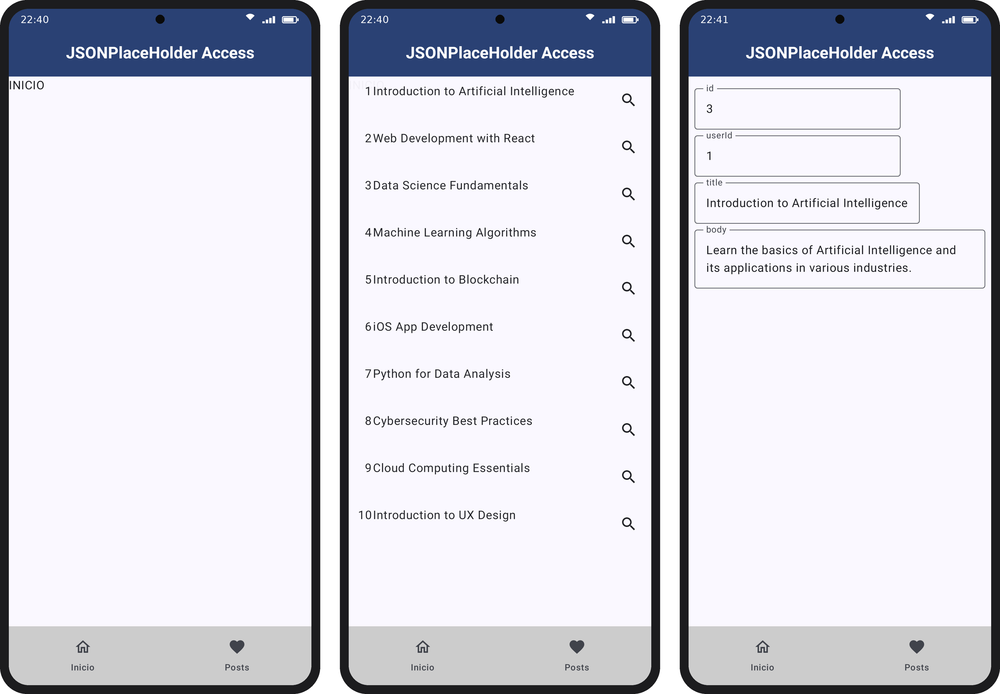
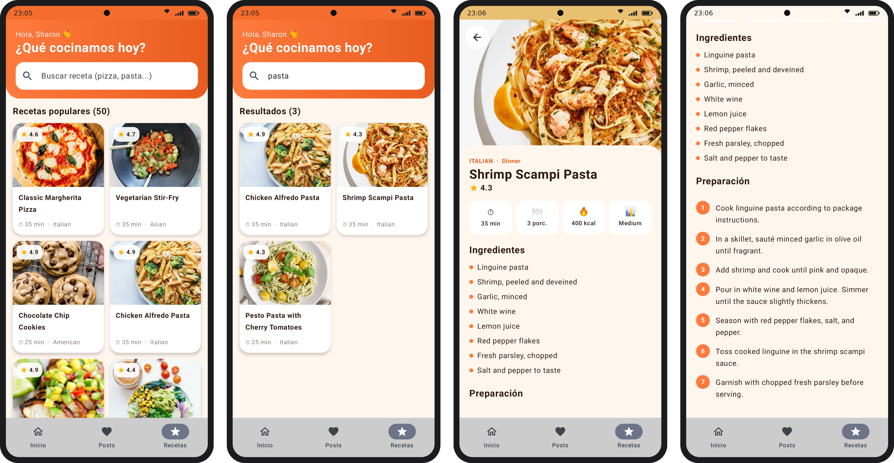

# Lab 09 – Consumo de API con Retrofit

Programación en Móviles · Sharon Jennifer Trujillo Sulca · Grupo D

App hecha con Kotlin, Jetpack Compose, Retrofit, Gson, Coil y Navigation Compose.

## Contenido

| Parte | Qué hace | Archivos |
|---|---|---|
| Parte guiada (tag `parte-guiada`) | Lista los posts de [JSONPlaceholder mock](https://json-placeholder.mock.beeceptor.com/) y muestra el detalle de cada uno | `PostModel.kt`, `PostApiService.kt`, `moduloPosts.kt`, `MainActivity.kt` |
| Ejercicio 1 (tag `ejercicio1`) | Recetario con la API de [DummyJSON](https://dummyjson.com/recipes): lista con fotos, buscador y detalle con ingredientes y preparación (MVVM) | carpeta `recetas/` |

## Videos

- Parte guiada: https://drive.google.com/file/d/1wQR3SYTuSLZ7rOQrtH4AEyfKPc_ZWE92/view?usp=sharing
- Ejercicio 1: https://drive.google.com/file/d/1BuAeQYwk5y74O2J9vFSbV6l5XMGu_rO-/view?usp=sharing

## Capturas

## Cómo correrlo

Abrir el proyecto en Android Studio, esperar el *Sync* de Gradle y darle **Run** en un emulador con Internet.
